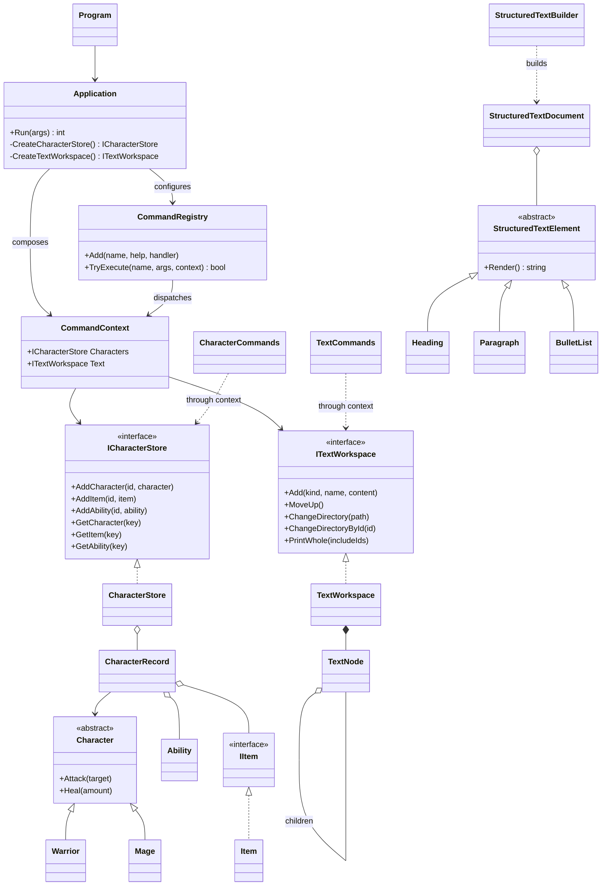

# Діаграма класів — модульний GameProject

## Пояснення

- `Program` лише передає аргументи запуску до `Application`.
- `Application` — точка композиції: обирає режим, створює реалізації інтерфейсів і реєструє команди.
- `ICharacterStore` та `ITextWorkspace` — межі між командним інтерфейсом і моделями. Конкретні реалізації можна замінити без переписування команд.
- `CharacterStore` відповідає за колекції персонажів, предметів, здібностей та пошук за ID/назвою.
- `Character` задає спільну поведінку; `Warrior` і `Mage` реалізують спеціалізовані типи персонажів.
- `TextWorkspace` керує навігацією та змінами дерева `TextNode`.
- `StructuredTextBuilder` дає fluent API для створення `StructuredTextDocument`, а `StructuredTextElement` забезпечує поліморфне рендерення.
- `CommandRegistry`, `CharacterCommands` і `TextCommands` розділяють маршрутизацію команд та логіку двох підсистем.
